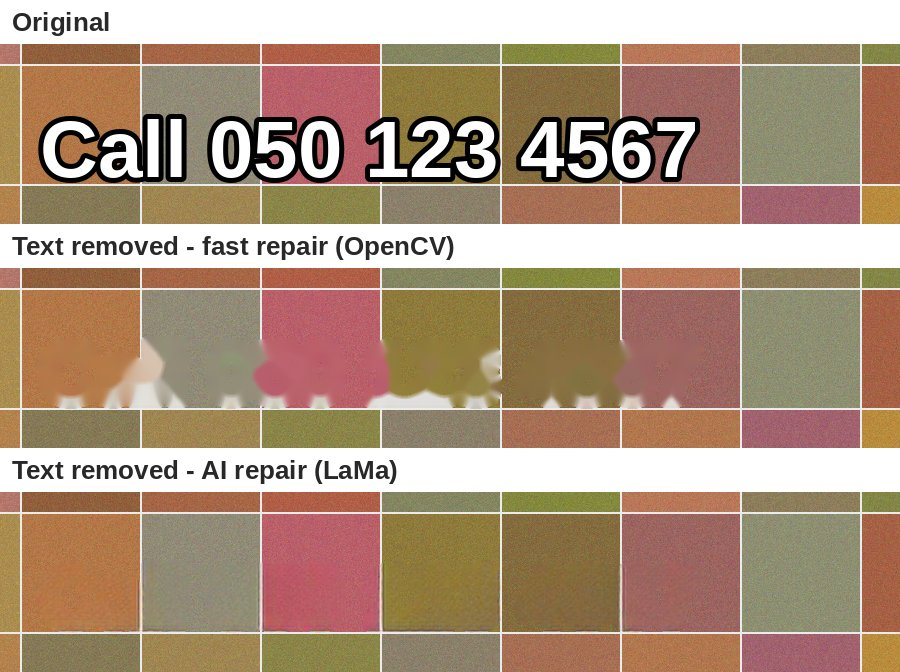

# VidTextSwap

**Find text in your videos and images and replace it, in the original style.**

Changed your phone number, branch, website or offer date? VidTextSwap scans a whole
folder of videos and images, finds every place the old text appears on screen,
and redraws the new text in the same place. It copies the size, colour, outline,
font weight and alignment, so the edit is hard to spot.


## What it does

- **Any text, many rules at once.** Phone numbers, addresses, URLs, prices, dates, in one run.
- **Matches the original look.** Fill colour, outline colour and thickness, bold vs. regular,
  condensed fonts, centred or left-aligned lines, ALL CAPS.
- **Reflows the line.** If the new text is shorter or longer, the rest of the line moves
  so there's no gap or overlap. Centred lines stay centred.
- **Videos stay natural.** The old text is erased frame by frame, so moving footage behind
  it looks right. The new text appears and disappears on the same frames as the old one.
  Audio is kept.
- **Phone numbers in any format.** `050 123 4567` also matches `0501234567`, `050-123-4567`
  and `+971 50 123 4567`.
- **Forgives OCR mistakes.** `0`/`O` and `1`/`l` mix-ups, missing spaces, a wrong letter.
- **Safe.** Originals are never touched. Updated copies, before/after previews and a
  `report.csv` go to a separate folder, and only files that changed are written.
- **Review mode.** Preview each file and approve or skip it before it's saved.
- **Runs locally.** Your media never leaves your computer. The only exception is the
  optional plain-language mode with a cloud AI, which sends the *text* found on screen
  (never images or video). Use Ollama to keep even that on your machine.

### AI inside

| Step | Model | Where it runs |
|---|---|---|
| Find and read text | PP-OCR detection + recognition networks ([RapidOCR](https://github.com/RapidAI/RapidOCR)) | Your computer |
| Repair the background behind old text | [LaMa](https://github.com/advimman/lama) inpainting (ONNX, ~90 MB, downloaded once) | Your computer |
| Turn "change the number to..." into exact rules | Your choice: **Ollama** (free, local), **Gemini** or **Groq** (free tiers), Claude, or any OpenAI-compatible server (optional) | Ollama: your computer. Others: cloud, text only |



Measuring the style and drawing the new text is plain computer vision on purpose:
it's fast and predictable, and the same input always gives the same result.

## Try it online (free)

[](https://colab.research.google.com/github/mohammedsaif/vidtextswap/blob/main/colab/VidTextSwap_demo.ipynb)

Click the badge, choose **Runtime → Run all**, and open the link it prints. The full web app
runs on Google's free machines, with nothing to install. The notebook can also process a
whole folder from your Google Drive.

Project page: **[huggingface.co/spaces/mohammedsaif/vidtextswap](https://huggingface.co/spaces/mohammedsaif/vidtextswap)**

## Install

Requires **Python 3.10+**. ffmpeg is installed automatically through `imageio-ffmpeg`.

```bash
git clone https://github.com/<you>/vidtextswap.git
cd vidtextswap
pip install -e ".[ai]"      # [ai] adds the Anthropic SDK for plain-language mode
```

**No terminal experience?** Download the ZIP, then double-click `run_windows.bat`
(Windows) or `run_mac.command` (Mac) and answer the questions.

## Use

**Interactive** (asks for the folder and what to replace):

```bash
vidtextswap
```

**One replacement:**

```bash
vidtextswap -i my_videos --find "050 123 4567" --replace "050 765 4321"
```

**Several at once:**

```bash
vidtextswap -i my_videos --find "Al Quoz" --replace "JLT" --find "31 Dec" --replace "15 Jan"
```

**In plain words:**

```bash
vidtextswap -i my_videos --instruct "our new number is 050 765 4321 and the offer now ends 15 Jan"
```

Choose the AI with `--llm` (default `auto` uses the first one that's set up):

| `--llm` | Cost | Setup |
|---|---|---|
| `ollama` | **Free**, unlimited, offline, private | Install [Ollama](https://ollama.com/download), then `ollama pull qwen2.5:7b` (~5 GB, 8 GB RAM recommended) |
| `gemini` | **Free tier** (daily limits) | Key from [Google AI Studio](https://aistudio.google.com/apikey), then `set GEMINI_API_KEY=...` |
| `groq` | **Free tier** (rate limits) | Key from [console.groq.com](https://console.groq.com/keys), then `set GROQ_API_KEY=...` |
| `claude` | Paid, per use | Key from [console.anthropic.com](https://console.anthropic.com), then `set ANTHROPIC_API_KEY=...` |
| `openai` | Depends on server | Any OpenAI-compatible server, e.g. LM Studio: `--llm-url http://localhost:1234/v1 --llm-model <name>` |

On Mac/Linux use `export NAME=value` instead of `set NAME=value`. One request per run
is all this feature needs, so free tiers are plenty. Free-tier cloud services may use
what you send to improve their models (check their terms). With Ollama, nothing leaves
your computer.

VidTextSwap reads all the on-screen text first, asks the AI which text to change, and
shows you the proposed rules before anything is edited. A rule that refers to text that
isn't actually on screen is dropped, so the model can't invent changes. The rules used
are saved to `rules_used.csv`, so you can re-run without the API.

**See what's there first** (no API needed):

```bash
vidtextswap -i my_videos --scan
```

This lists every phone number, website, email, price, date and offer found on screen,
and how many files each appears in.

**From a CSV** (see [`examples/replacements.csv`](examples/replacements.csv)):

```csv
find,replace,type,font
050 123 4567,050 765 4321,phone,
Al Quoz Branch,JLT Branch,text,
www.oldsite.ae,www.newsite.ae,,
```

```bash
vidtextswap -i my_videos --rules replacements.csv --review
```

`type` is optional (`phone`, `text`, or empty for auto). `font` is optional, a `.ttf`/`.otf`
to use for that rule only.

### Web app (local)

```bash
pip install -e ".[web]"
python space/app.py          # then open http://127.0.0.1:7860
```

`space/` can also be deployed as a Gradio Space on Hugging Face (this needs a PRO plan for
Gradio Spaces since mid-2026). `showcase/` is the free static project page.

### From Python

```python
from vidtextswap import Rule
from vidtextswap.api import process_files

results = process_files(["post.jpg", "reel.mp4"], [Rule("050 123 4567", "050 765 4321")], "out")
for r in results:
    print(r.file, r.status, r.output)
```

### Output

```
my_videos_updated/
├── reels/clip1.mp4          # updated copies, same folder layout as the input
├── _previews/reels/clip1.jpg   # before | after for every edit - check these
├── report.csv               # every file: updated / no match / skipped / error, and when the text was on screen
└── rules_used.csv           # the exact rules applied - reuse with --rules
```

At the end, VidTextSwap also lists caption or text files (`.json`, `.html`, `.txt`,
`.srt`, `.vtt`) that still mention the old text. This is handy with an Instagram
"Download your information" export.

### Options

| Option | What it does |
|---|---|
| `-i, --input` | Folder (searched recursively) or a single file |
| `-o, --output` | Where updated copies go (default `<input>_updated`) |
| `--find / --replace` | A replacement pair. Repeat for more |
| `--rules FILE.csv` | Replacements from a CSV |
| `--review` | Preview and approve each file before saving |
| `--dry-run` | Only report where the text appears; write nothing |
| `--fuzz 0.85` | Tolerance for OCR mistakes (1.0 = exact only) |
| `--step 0.5` | Seconds between scanned video frames. Lower it if text flashes briefly |
| `--font FILE` | Font for all new text (default: picks bold or regular automatically) |
| `--exact-case` | Draw replacements exactly as typed (default: follow ALL-CAPS originals) |
| `--no-reflow` | Don't move neighbouring words; fit the new text into the old space |
| `--inpaint auto\|ai\|fast` | Background repair. `auto` (default): AI for images and still video shots, fast while the camera moves. `ai`: AI everywhere (slower). `fast`: OpenCV only |
| `--instruct "TEXT"` | Describe the change in plain words |
| `--llm` | AI for `--instruct`: `auto`, `ollama`, `gemini`, `groq`, `claude`, `openai` |
| `--llm-model` | Model name (defaults: `qwen2.5:7b`, `gemini-2.5-flash`, `llama-3.3-70b-versatile`, `claude-haiku-5-5`) |
| `--llm-url` | Server address for `ollama`/`openai` (e.g. LM Studio `http://localhost:1234/v1`) |
| `--yes` | Accept the rules proposed by `--instruct` without asking |
| `--scan` | List the text found on screen and stop |

## How it works

1. **Find.** [RapidOCR](https://github.com/RapidAI/RapidOCR) reads the frame. Video is sampled
   every `--step` seconds, then frame by frame around each appearance for exact timing.
   Rules are matched with normalisation (case, spacing, OCR look-alikes) and fuzzy matching.
2. **Measure.** Real word edges and text height come from the pixels, not the OCR boxes.
   The fill and outline colours are separated with k-means, and an outline is told apart
   from anti-aliasing.
3. **Match the font.** It tries bold and regular fonts, sized to the original ink height,
   picks the one with the closest stroke density, and copies the original's width.
4. **Repair.** The old letters are removed with LaMa, an AI inpainting model that rebuilds
   patterns like tiles, grout lines and textures. In video, LaMa runs once per still
   shot and the result is reused while the background doesn't move. Frames where the
   camera moves use fast OpenCV inpainting, where motion hides small flaws.
5. **Redraw.** The new text goes on the same baseline, and the rest of the line moves
   if needed. Video is re-encoded with H.264 (CRF 18), keeping the original audio.

On busy backgrounds (tiles, photos), text is found by its own colours (colours present
in the text box but rare around it) rather than by contrast with a single background
colour.

## Limits

- Text that is **spoken** in the audio isn't changed.
- **Animated text** (moving, scaling, typing on) is edited at its main position only.
  Check those in the preview.
- **Unusual decorative or handwritten fonts** are redrawn in the nearest standard font.
  Pass your brand font with `--font` for a closer match.
- Latin script and digits are best supported. **Arabic** is on the roadmap.
- AI background repair takes about 1-4 s per edit on a CPU. A long video with a moving
  camera and `--inpaint ai` can take a while. The default `auto` keeps this fast.
- The LaMa model is downloaded on first use (~90 MB) from OpenCV's model zoo on GitHub,
  with a SHA-256 check. Offline? Download it yourself and set `VIDTEXTSWAP_LAMA_MODEL`
  to its path.

## Roadmap

- [ ] Arabic and other scripts (OCR model + right-to-left layout)
- [x] Web app: upload, review in the browser, download (Hugging Face Space)
- [x] AI background repair (LaMa)
- [x] Plain-language instructions (Ollama, Gemini, Groq, Claude or any OpenAI-compatible AI)
- [ ] Automatic font identification from the frame
- [ ] Animated and moving text tracking
- [ ] Logo and QR-code replacement
- [ ] Re-publish to Instagram via the Graph API (Business accounts)

## Development

```bash
pip install -e ".[dev]"
pytest
```

The tests generate their own images and video, run real OCR on the output, and check
that the new text is there, the old text is gone, neighbouring words are untouched,
frames before the text appears are unchanged, and audio is kept. The plain-language
mode is tested against local stand-in servers that speak the Ollama and
OpenAI-compatible APIs, and a stand-in for Claude, so no API key is needed. The real LaMa
test runs when the model is downloaded (`VIDTEXTSWAP_TEST_AI=1`).

## License

MIT © Mohammed Saif
